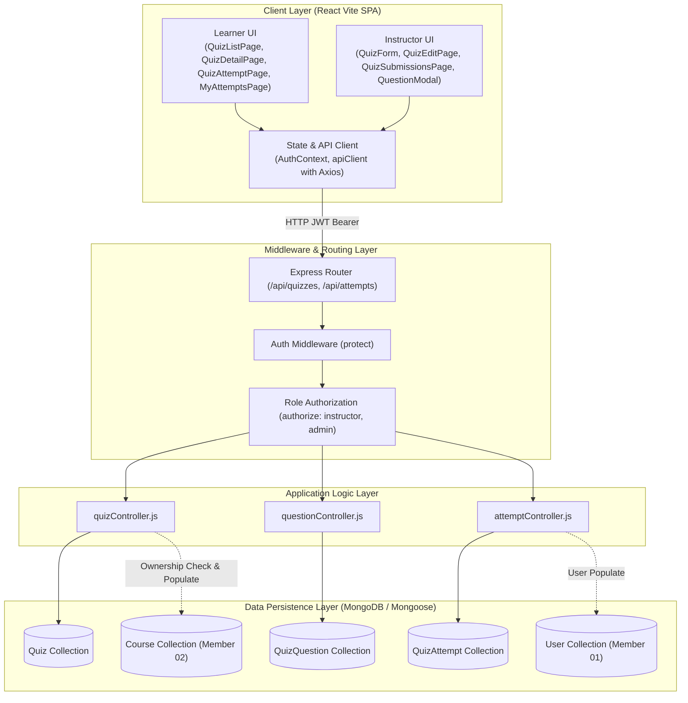

# SkillNest – Member 05: Technical Documentation
## Module: Quiz & Assessment Management

**Student Name:** R.D.T.S. Karunarathna
**Student Registration Number:** `SEU/IS/22/ICT/087`
**Course Code:** SWT22022 – Integrated Application Development (IAD) – Group B
**Project:** SkillNest – Open Course-ware and Technical Skill Development Platform
**Target Repository:** `https://github.com/RusiruCH/skillnest.git`
**Branch:** `main`

---

## 1. Module Introduction & Objectives

### 1.1 Overview
The **Quiz & Assessment Management** module (Member 05) serves as the primary evaluation and competency verification engine within the SkillNest technical learning ecosystem. It bridges theoretical course consumption (Member 02) and code problem solving (Member 04) with structured Multiple Choice Question (MCQ) assessments.

Assessments in SkillNest are designed to be pedagogical tools as well as rigorous testing mechanisms. Instructors can craft timed quizzes, define passing thresholds, structure and reorder questions, link assessments to published courses, preview quizzes in real time, and inspect deep class analytics. Learners experience a focused, timed assessment interface with real-time feedback, auto-grading, and comprehensive attempt histories.

### 1.2 Core Objectives
- **Secure Auto-Evaluation:** Eliminate grading latency through zero-latency, server-authoritative auto-grading of MCQ submissions.
- **Strict Anti-Cheating & Answer Protection:** Prevent client-side inspection or network snooping of answer keys by enforcing database projection constraints (`select: false` on answer keys) until submission is finalized.
- **Configurable Assessment Governance:** Allow instructors to enforce duration limits, active assessment scheduling windows, and configurable attempt ceilings ($1 \le N \le 20$).
- **Instructor Self-Test & Preview Isolation:** Provide instructors with a real-time student-facing preview of their quizzes without polluting class performance analytics or incrementing attempt counts.
- **Course Integration:** Seamlessly link quizzes to Member 02 Course entities while guaranteeing instructor ownership isolation.

---

## 2. Functional Requirements (FR)

| Requirement ID | Module Area | Requirement Description | User Role |
| :--- | :--- | :--- | :--- |
| **FR-01** | Quiz Authoring | Instructors can create, edit, delete, and publish/unpublish quizzes. | Instructor, Admin |
| **FR-02** | Question Management | Instructors can add, edit, delete, and reorder MCQ questions with 2 to 6 options and custom mark allocations. | Instructor, Admin |
| **FR-03** | Question Reordering | Instructors can sequence questions via drag-and-drop or accessible controls; order persists in MongoDB and dictates delivery sequence. | Instructor, Admin |
| **FR-04** | Course Linkage | Instructors can link quizzes to their owned courses via a smart dropdown; invalid or foreign courses are blocked. | Instructor, Admin |
| **FR-05** | Instructor Preview | Instructors can preview draft/published quizzes using the learner UI without exposing answers or polluting class stats. | Instructor, Admin |
| **FR-06** | Assessment Session | Learners can launch quizzes within the scheduled window, receive questions, and track remaining time via a countdown timer. | Learner |
| **FR-07** | Auto-Grading & Results | Server evaluates submissions, scores correct answers, computes percentage, assigns Pass/Fail status, and reveals review feedback. | Learner, Instructor |
| **FR-08** | Attempt Ceilings | System enforces configurable `maxAttempts` ($1 \le N \le 20$); excess attempts are blocked with HTTP `409 Conflict`. | Learner |
| **FR-09** | My Attempts History | Learners can view a personal history of all attempts with scores, pass status, and direct result review links. | Learner |
| **FR-10** | Analytics Dashboard | Instructors can monitor submission counts, average score, pass rate, highest/lowest marks, and individual learner performances. | Instructor, Admin |

---

## 3. Non-Functional Requirements (NFR)

- **Security & Confidentiality (NFR-01):** Correct options (`correctOptionId`) and explanations must never be returned to learners before submission. Even direct network inspection via DevTools must yield zero answer leakage.
- **Server-Side Enforcement (NFR-02):** Assessment timing is enforced by the server clock (`startedAt + duration`). Submissions arriving beyond the grace threshold are rejected or auto-submitted as expired.
- **Data Integrity & Isolation (NFR-03):** Instructor preview tests must set `isTestAttempt: true` and be completely filtered out of class analytics, pass rates, and learner attempt limits.
- **Performance & Scalability (NFR-04):** MongoDB queries utilize compound unique indexes (`{ quiz: 1, learner: 1, attemptNumber: 1 }`) to ensure $O(1)$ attempt tracking and duplicate prevention.
- **Responsiveness & UX (NFR-05):** Fluid layout across mobile, tablet, and desktop viewports using CSS variable theming and accessible UI components.
- **Maintainability & Zero-Regression (NFR-06):** Complete isolation of foreign modules (Member 01 Users, Member 02 Courses, Member 04 Challenges) without breaking changes or duplicate models.

---

## 4. System Architecture

### 4.1 High-Level Architecture Overview
SkillNest follows a modular Model-View-Controller (MVC) architecture with a decoupled React SPA frontend communicating with an Express.js REST API over HTTP/JSON, backed by MongoDB.



---

## 5. Backend Architecture & Controller Design

### 5.1 Controller Responsibilities
1. **`quizController.js`:**
   - Handles Quiz CRUD, draft/publish lifecycle toggling, course linking, and population.
   - Restricts modification and deletion to the quiz owner instructor or administrators.
2. **`questionController.js`:**
   - Manages question bank operations for individual quizzes.
   - Implements `reorderQuestions` to persist sequence indexes in bulk using parallel MongoDB update promises.
   - Enforces 2 to 6 option boundary validation and `correctOptionId` referential validation.
3. **`attemptController.js`:**
   - Handles `startAttempt`, validating schedule window, draft permissions, and active session resumption.
   - Enforces configurable `maxAttempts` quotas for learners.
   - Conducts server-authoritative auto-grading in `submitAttempt`.
   - Aggregates submissions, pass rates, average marks, and highest/lowest KPIs in `getQuizSubmissions` while filtering out test attempts.

---

## 6. Frontend Architecture & Component Hierarchy

```text
client/src/
├── components/quiz/
│   ├── CountdownTimer.jsx       # Real-time circular/badge countdown with time-expire callback
│   ├── QuestionItem.jsx         # Multi-mode MCQ item (attempt, review, manage + drag-and-drop)
│   ├── QuestionModal.jsx        # Modal form for adding/editing question text, options, and marks
│   ├── QuizCard.jsx             # Grid card showing status, duration, pass mark, course, and actions
│   └── QuizForm.jsx             # Comprehensive quiz configuration form with course dropdown
├── pages/quiz/
│   ├── MyAttemptsPage.jsx       # Personal attempt history table with filters and review buttons
│   ├── QuizAttemptPage.jsx      # Sticky test bar, progress bar, questions, and preview banner
│   ├── QuizCreatePage.jsx       # Instructor quiz authoring page
│   ├── QuizDetailPage.jsx       # Assessment rules, metrics grid, course badge, and launch button
│   ├── QuizEditPage.jsx         # Dual-tab dashboard (Question Bank with drag-and-drop & Settings)
│   ├── QuizListPage.jsx         # Main catalog with role-based controls and search
│   ├── QuizResultPage.jsx       # Scored performance card, pass/fail badge, and question breakdown
│   └── QuizSubmissionsPage.jsx  # Instructor analytics dashboard (KPIs, search, filters, review links)
```

---

## 7. Authentication, Role-Based Access Control & Security

### 7.1 Role-Based Access Control (RBAC) Matrix

| Endpoint / Operation | Learner | Instructor (Owner) | Instructor (Non-Owner) | Administrator |
| :--- | :---: | :---: | :---: | :---: |
| Browse Published Quizzes (`GET /api/quizzes`) | Allowed | Allowed | Allowed | Allowed |
| View Draft Quizzes (`GET /api/quizzes`) | Blocked | Allowed | Blocked | Allowed |
| Create Quiz (`POST /api/quizzes`) | Blocked | Allowed | Allowed | Allowed |
| Edit / Delete Quiz (`PUT / DELETE /api/quizzes/:id`) | Blocked | Allowed | Blocked (`403`) | Allowed |
| Reorder Questions (`PATCH /api/quizzes/:id/questions/reorder`) | Blocked | Allowed | Blocked (`403`) | Allowed |
| Preview Draft Quiz (`POST /api/attempts/start`) | Blocked | Allowed (`isTestAttempt`) | Blocked (`403`) | Allowed |
| Attempt Published Quiz (`POST /api/attempts/start`) | Allowed | Allowed | Blocked (`403`) | Allowed |
| Submit Quiz Attempt (`POST /api/attempts/:id/submit`) | Allowed | Allowed | Blocked (`403`) | Allowed |
| View Personal History (`GET /api/attempts/my`) | Own Only | Own Only | Own Only | All |
| View Class Analytics (`GET /api/quizzes/:id/attempts`) | Blocked | Allowed | Blocked (`403`) | Allowed |

### 7.2 Security Implementation Highlights
- **Hidden Answer Keys (`select: false`):** Both `correctOptionId` and `explanation` are configured with `select: false` at the schema level. Learner API queries never receive these fields before auto-grading.
- **Server-Side Scoring:** Answers submitted by clients contain only `{ question: ObjectId, selectedOptionId: ObjectId }`. Scores and percentages are computed purely by server logic.
- **Tamper-Proof Question Integrity:** Pre-validation hooks on `QuizQuestion` verify that `correctOptionId` references an existing subdocument `_id` within the question's `options` array.
- **Attempt Isolation:** Prevents concurrent duplicate submissions through atomic database queries and compound unique constraints.
