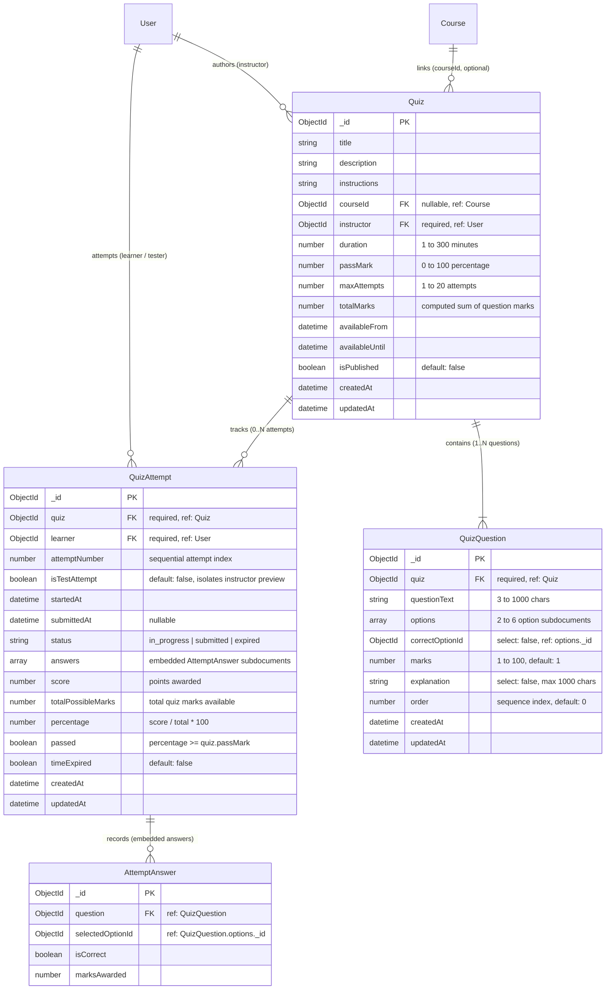

# SkillNest – Member 05: Database Documentation
## Module: Quiz & Assessment Management

**Student Name:** R.D.T.S. Karunarathna
**Student Registration Number:** `SEU/IS/22/ICT/087`
**Database Engine:** MongoDB (Document-Oriented Database)
**ODM Library:** Mongoose (v8.x)

---

## 1. Entity-Relationship Diagram (ERD)

The following diagram illustrates the relationship between the Member 05 Quiz collections and the integration points with Member 01 (`User`) and Member 02 (`Course`).



---

## 2. Schema Specifications

### 2.1 `Quiz` Schema (`server/models/Quiz.js`)
Represents an individual assessment module created by an instructor.

| Field Name | BSON Type | Constraints & Rules | Default Value | Description |
| :--- | :--- | :--- | :--- | :--- |
| `_id` | `ObjectId` | Auto-generated PK | Auto | Unique identifier |
| `title` | `String` | Required, trimmed, min: 3, max: 150 | — | Assessment title |
| `description` | `String` | Trimmed, max: 1000 | `''` | Brief overview |
| `instructions` | `String` | Trimmed, max: 2000 | Standard notice | Test rules shown to learner before starting |
| `courseId` | `ObjectId` | Nullable, `ref: 'Course'` | `null` | Integration reference to Member 02 Course |
| `instructor` | `ObjectId` | Required, `ref: 'User'`, indexed | — | Creator instructor identifier |
| `duration` | `Number` | Required, min: 1, max: 300 | — | Time limit in minutes |
| `passMark` | `Number` | Required, min: 0, max: 100 | `50` | Passing percentage cutoff |
| `maxAttempts` | `Number` | Required, min: 1, max: 20 | `1` | Maximum attempts allowed per learner |
| `totalMarks` | `Number` | Min: 0 | `0` | Sum of all active question marks |
| `availableFrom` | `Date` | Required | — | Opening date/time |
| `availableUntil`| `Date` | Required, must be $>$ `availableFrom` | — | Closing date/time |
| `isPublished` | `Boolean` | Required | `false` | Visibility flag for learners |
| `timestamps` | `Date` | `createdAt`, `updatedAt` | Auto | Audit timestamps |

#### Virtual Property: `status`
Computes the dynamic availability state of the quiz based on the current wall-clock time:
- `'draft'`: When `isPublished === false`
- `'upcoming'`: When `now < availableFrom`
- `'closed'`: When `now > availableUntil`
- `'active'`: When published and `availableFrom <= now <= availableUntil`

---

### 2.2 `QuizQuestion` Schema (`server/models/QuizQuestion.js`)
Represents a Multiple Choice Question (MCQ) item tied to a parent Quiz.

| Field Name | BSON Type | Constraints & Rules | Default Value | Description |
| :--- | :--- | :--- | :--- | :--- |
| `_id` | `ObjectId` | Auto-generated PK | Auto | Question identifier |
| `quiz` | `ObjectId` | Required, `ref: 'Quiz'`, indexed | — | Parent quiz reference |
| `questionText` | `String` | Required, trimmed, min: 3, max: 1000 | — | Question prompt |
| `options` | `Array` | Subdocument array, length: 2 to 6 | — | Defined answer options |
| `options[].text` | `String` | Required, trimmed, max: 500 | — | Option display text |
| `correctOptionId`| `ObjectId` | Required, **`select: false`** | — | **Security field:** Reference to correct option `_id` |
| `marks` | `Number` | Required, min: 1, max: 100 | `1` | Mark allocation for this question |
| `explanation` | `String` | Trimmed, max: 1000, **`select: false`** | `''` | Post-test review explanation |
| `order` | `Number` | Integer, indexed | `0` | Sequential sort position |

#### Pre-Validation Hook
Enforces referential integrity between `correctOptionId` and `options[]._id`:
```javascript
quizQuestionSchema.pre('validate', function (next) {
  if (this.options && this.options.length > 0 && this.correctOptionId) {
    const exists = this.options.some((opt) =>
      opt._id.toString() === this.correctOptionId.toString()
    );
    if (!exists) {
      this.invalidate('correctOptionId', 'The correct option ID must match one of the defined options');
    }
  }
  next();
});
```

---

### 2.3 `QuizAttempt` Schema (`server/models/QuizAttempt.js`)
Represents a student or instructor test execution instance.

| Field Name | BSON Type | Constraints & Rules | Default Value | Description |
| :--- | :--- | :--- | :--- | :--- |
| `_id` | `ObjectId` | Auto-generated PK | Auto | Attempt identifier |
| `quiz` | `ObjectId` | Required, `ref: 'Quiz'` | — | Target quiz reference |
| `learner` | `ObjectId` | Required, `ref: 'User'` | — | Attempting user identifier |
| `attemptNumber` | `Number` | Required, min: 1 | `1` | Sequence of attempt for this user and quiz |
| `isTestAttempt` | `Boolean` | Indexed | `false` | **Isolation flag:** `true` for instructor preview tests |
| `startedAt` | `Date` | Required | `Date.now` | Initiation timestamp |
| `submittedAt` | `Date` | Nullable | `null` | Submission completion timestamp |
| `status` | `String` | Enum: `['in_progress', 'submitted', 'expired']` | `'in_progress'` | Attempt lifecycle status |
| `answers` | `Array` | Subdocument array | `[]` | Selected choices with grading results |
| `score` | `Number` | Min: 0 | `0` | Points awarded |
| `totalPossibleMarks` | `Number` | Min: 0 | `0` | Max marks available on quiz |
| `percentage` | `Number` | Min: 0, max: 100 | `0` | Evaluated score percentage |
| `passed` | `Boolean` | Boolean | `false` | Whether percentage $\ge$ passMark |
| `timeExpired` | `Boolean` | Boolean | `false` | Flag indicating auto-expiry |

---

## 3. MongoDB Indexes

The following database indexes are active in the MongoDB cluster to ensure query efficiency, strict uniqueness, and data integrity:

| Collection | Index Keys | Type | Purpose |
| :--- | :--- | :--- | :--- |
| `quizzes` | `{ instructor: 1 }` | Single-field | Fast lookups of an instructor's quiz catalog |
| `quizzes` | `{ courseId: 1 }` | Single-field | Efficient filtering of quizzes by course |
| `quizzes` | `{ isPublished: 1, availableFrom: 1, availableUntil: 1 }` | Compound | Fast resolution of active quizzes for learners |
| `quizquestions` | `{ quiz: 1, order: 1 }` | Compound | Delivers ordered question sequence for exams |
| `quizattempts` | `{ quiz: 1, learner: 1, attemptNumber: 1 }` | **Compound Unique** | Guarantees sequential attempt integrity and prevents race conditions |
| `quizattempts` | `{ learner: 1, isTestAttempt: 1, status: 1 }` | Compound | High-performance resolution for "My Attempts" dashboard |
| `quizattempts` | `{ quiz: 1, isTestAttempt: 1, status: 1 }` | Compound | High-performance resolution for class analytics aggregation |

---

## 4. Test Attempt Isolation & Integrity Design

### 4.1 Instructor Preview Isolation
To allow instructors to verify their assessments without compromising academic statistics, the `isTestAttempt` boolean flag governs all lifecycle stages:
1. **Attempt Launch (`startAttempt`):** When `user.role === 'instructor'` and `quiz.instructor === user._id`, the attempt is created with `isTestAttempt: true`.
2. **Quota Checks:** `countDocuments({ quiz, learner, isTestAttempt: false })` ensures instructor preview tests do not count toward learner `maxAttempts` quotas.
3. **Class Statistics Aggregation (`getQuizSubmissions`):** The query `{ quiz, isTestAttempt: { $ne: true } }` ensures instructor scores, 100% test answers, or incomplete preview sessions are completely excluded from class pass rates, averages, and student performance tables.
4. **My Attempts Page (`getMyAttempts`):** Uses `{ learner: req.user._id, isTestAttempt: { $ne: true } }` so preview test records do not clutter learner attempt records.
