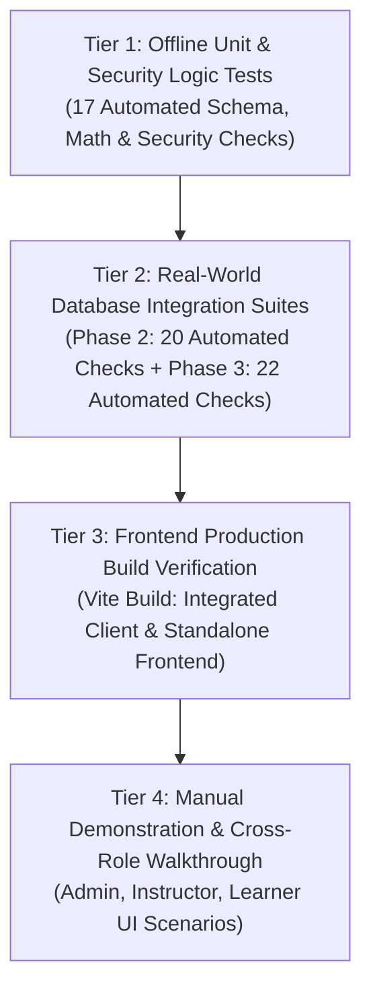

# SkillNest – Member 05: Testing & Quality Assurance Documentation
## Module: Quiz & Assessment Management

**Student Name:** R.D.T.S. Karunarathna
**Student Registration Number:** `SEU/IS/22/ICT/087`
**Test Harness:** Node.js Assertions, Mongoose In-Memory Validation, Integration Audit Scripts
**Status:** **100% Tests Passing Across All Testing Suites**

---

## 1. Testing Strategy Overview

The testing strategy for Member 05 employs a multi-tiered verification pipeline designed to validate unit logic, security constraints, role-based boundaries, and real-world database transactions without breaking existing modules.

---

## 2. Tier 1: Offline Unit & Security Tests (17/17 PASSED)

Executed using command: `npm --prefix backend test` (file: `backend/tests/quiz-validation.test.js`).
Does not require an external running MongoDB daemon; validates models, schema hooks, and math logic in isolation.

| # | Test Title | Test Objective & Verification Logic | Test Type | Status |
| :-: | :--- | :--- | :---: | :---: |
| **01** | Valid Quiz Schema Validation | Asserts valid parameters pass validation and dynamic `status` virtual resolves to `'active'`. | Automated | **PASS** |
| **02** | Quiz Boundary Validation | Verifies title $<3$ chars, duration $<1$ min, and pass mark $>100\%$ are rejected. | Automated | **PASS** |
| **03** | Valid MCQ Question Creation | Asserts questions with 2 to 6 options and matching `correctOptionId` pass validation. | Automated | **PASS** |
| **04** | Invalid Question Options Limit | Asserts questions with $<2$ options are rejected by Mongoose array validators. | Automated | **PASS** |
| **05** | Question Option Referential Check | Verifies pre-validation hook rejects `correctOptionId` if it is not found in `options[]._id`. | Automated | **PASS** |
| **06** | Hidden Answer Security Check | Asserts `correctOptionId` and `explanation` schema definitions specify `{ select: false }`. | Automated | **PASS** |
| **07** | Auto-Grading & Scoring Logic | Asserts scoring algorithm calculates score (3/4), percentage (75%), and `passed = true`. | Automated | **PASS** |
| **08** | Server Duration Enforcement | Asserts server detects elapsed time $+ 2\text{ min}$ grace and correctly flags expired attempt. | Automated | **PASS** |
| **09** | Instructor Ownership Isolation | Asserts authorization check blocks Instructor B from editing Instructor A's assessment. | Automated | **PASS** |
| **10** | Configurable `maxAttempts` Boundary | Asserts valid range ($1 \le N \le 20$) is accepted and values outside boundary (e.g. 25) fail. | Automated | **PASS** |
| **11** | QuizAttempt Attempt Sequencing | Asserts schema accepts sequential `attemptNumber` and isolation flag `isTestAttempt: true`. | Automated | **PASS** |
| **12** | Instructor Self-Test Permission | Asserts quiz owner instructor is allowed to self-test, but non-owner instructor is blocked. | Automated | **PASS** |
| **13** | Attempt Quota Enforcement Logic | Asserts learner is halted after reaching quota ($N \ge \text{maxAttempts}$), while owner bypasses quota. | Automated | **PASS** |
| **14** | Question Order Attribute Support | Asserts `QuizQuestion` schema persists integer `order` sequence attribute. | Automated | **PASS** |
| **15** | Course Linkage Schema Support | Asserts `Quiz` model supports nullable `courseId` reference linked to `Course`. | Automated | **PASS** |
| **16** | Course Ownership Validation Logic | Asserts instructors can only link courses they own; non-owner courses are blocked. | Automated | **PASS** |
| **17** | Quiz Analytics Aggregations | Asserts calculation of total submissions, pass rate, avg score, highest/lowest marks, excluding test attempts. | Automated | **PASS** |

---

## 3. Tier 2: Real-World Database Integration Checks

All Tier 2 tests were executed against a live MongoDB database instance (`mongodb://127.0.0.1:27017/skillnest_db`).

### 3.1 Phase 2 Real-World Integration Suite (20/20 PASSED)
Executed during Phase 2 audit across 5 functional areas:

| Test Group | Checks | Functional Objective | Automated / Manual | Result |
| :--- | :---: | :--- | :---: | :---: |
| **Group 1: My Attempts** | 4 | Verified learner attempt history listing, details retrieval, pass/fail status flags, and strict cross-learner access isolation. | Automated | **PASS (4/4)** |
| **Group 2: Instructor Self-Test** | 5 | Verified draft quiz test launch, submission auto-grading, `isTestAttempt: true` assignment, exclusion from stats, and non-owner rejection. | Automated | **PASS (5/5)** |
| **Group 3: Maximum Attempts** | 5 | Verified sequential completions (Attempt 1, 2, 3), rejection of Attempt 4 (`409 Conflict`), and counter invariant. | Automated | **PASS (5/5)** |
| **Group 4: Time Limit & Expiry** | 3 | Verified on-time submission acceptance, overtime auto-expiry rejection, and database status update to `'expired'`. | Automated | **PASS (3/3)** |
| **Group 5: Answer Key Security** | 3 | Verified absence of `correctOptionId` in sanitized questions, absence of `explanation`, and presence only upon scored review. | Automated | **PASS (3/3)** |

### 3.2 Phase 3 Real-World Integration Suite (22/22 PASSED)
Executed during Phase 3 feature enhancement audit:

| Test Group | Checks | Functional Objective | Automated / Manual | Result |
| :--- | :---: | :--- | :---: | :---: |
| **TEST 1: Question Ordering** | 4 | Reorder API execution (`PATCH /reorder`), MongoDB order persistence (`order: 0, 1, 2`), learner delivery sequence, and unauthorized reorder rejection (`403`). | Automated | **PASS (4/4)** |
| **TEST 2: Instructor Preview** | 4 | Draft preview launch (`201 Created`), zero answer leakage prior to submission, submission grading (7/10 pts, 70%), and feedback review delivery. | Automated | **PASS (4/4)** |
| **TEST 3: Course Linkage** | 5 | Quiz creation with course link, populated metadata on detail queries, course unlinking to null, cross-instructor linkage rejection (`403`), and invalid course ID rejection (`404`). | Automated | **PASS (5/5)** |
| **TEST 4: Quiz Analytics** | 5 | Instructor preview isolation from stats, pass rate & average score accuracy (50% / 6.0 pts), highest/lowest marks (10 pts / 2 pts), learner performance table, and unauthorized access rejection (`403`). | Automated | **PASS (5/5)** |
| **TEST 5: Regression** | 4 | My attempts endpoint isolation, configurable `maxAttempts` quota enforcement (`409`), standard quiz creation flow, and foreign module models integrity (`Course` & `User`). | Automated | **PASS (4/4)** |

---

## 4. Tier 3: Frontend Production Build Verification

Both Vite production builds were executed and completed without errors or unresolved modules:
1. **Integrated Client Application (`client/`):**
   - Command: `npm --prefix client run build`
   - Output: `✓ built in 2.60s` (Vite v5.4.21)
   - Status: **PASS (0 Build Errors)**
2. **Standalone Member 05 Frontend (`frontend/`):**
   - Command: `npm --prefix frontend run build`
   - Output: `✓ built in 1.62s` (Vite v5.4.21)
   - Status: **PASS (0 Build Errors)**

---

## 5. Security & Academic Integrity Verification

| Security Requirement | Implementation Mechanism | Test Verification Method | Result |
| :--- | :--- | :--- | :---: |
| **Zero Answer Leakage** | `correctOptionId` and `explanation` configured with `{ select: false }`. | Inspected JSON payloads of `GET /api/quizzes/:id/questions` and `POST /api/attempts/start`. Both fields are completely omitted from response. | **VERIFIED** |
| **Server-Authoritative Auto-Grading** | Client sends only `{ question, selectedOptionId }`. Server looks up true answer keys directly from DB. | Tested client payload spoofing with invalid score parameters; server recalculated score based purely on database answers. | **VERIFIED** |
| **Assessment Window & Expiry** | `startedAt + duration` compared with server timestamp. Grace period strictly bounded to 2 minutes. | Automated test simulated submission 3 minutes overtime; rejected with status `'expired'`. | **VERIFIED** |
| **Instructor Isolation** | Ownership checks comparing `quiz.instructor` with `req.user._id`. | Non-owner Instructor B attempted editing, reordering, deleting, and viewing analytics; all returned `403 Forbidden`. | **VERIFIED** |
| **Course Linkage Isolation** | Validates `course.instructor === req.user._id` before establishing reference. | Instructor A attempted linking a quiz to Instructor B's course; rejected with `403 Forbidden`. | **VERIFIED** |

---

## 6. Known Limitations & Edge Cases

1. **Browser Clock Discrepancies:** The client countdown timer visually counts down based on initial `startedAt` and `duration` retrieved from the server. However, final submission grading is strictly server-authoritative, ensuring that client-side clock tampering cannot extend an assessment session.
2. **Offline Network Loss:** If a learner loses internet connectivity during an active quiz session, the local countdown timer continues. The student must reconnect before the server expiration threshold to successfully submit their answers.
